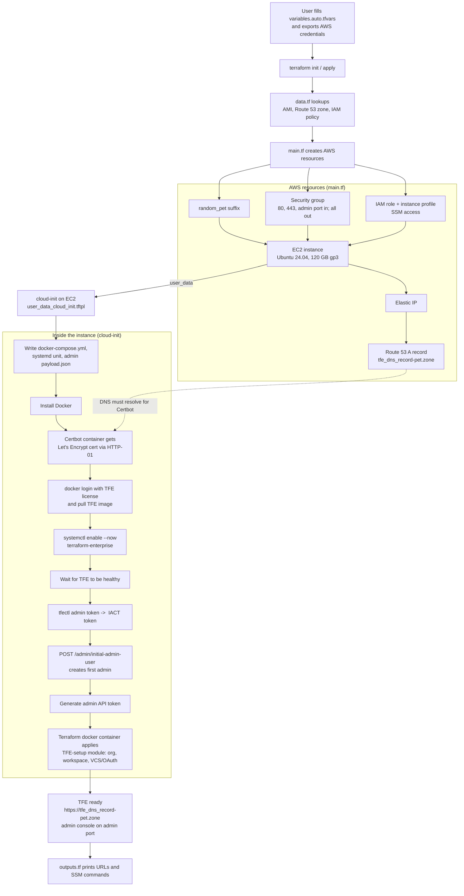

# tfe-fdo-docker

Terraform code that deploys a single-node **Terraform Enterprise (TFE) Flexible Deployment Option (FDO)** on AWS, running as a **Docker Compose** service in **`disk` operational mode**. It is intended for labs, demos, support reproductions and testing, not for production.

With one `terraform apply` it:

1. Creates an Ubuntu 24.04 EC2 instance, Elastic IP, security group and an SSM-enabled IAM role.
2. Creates a Route 53 A record such as `<tfe_dns_record>-<random-pet>.<hosted_zone_name>`.
3. Uses cloud-init to install Docker, get a Let's Encrypt certificate (Certbot, HTTP-01), pull the TFE image and start TFE.
4. Bootstraps TFE: creates the initial admin user, then runs a second Terraform configuration (using the `tfe` provider) that creates the initial organization, workspace and VCS (GitHub OAuth) setup.

---

## Repository layout

| File | Purpose |
|---|---|
| [`providers.tf`](providers.tf) | Terraform version pin (`1.15.6`), `cloud {}` block (HCP Terraform / TFE remote backend), `aws` (`~> 6.0`) and `random` (`~> 3.6`) providers. |
| [`variables.tf`](variables.tf) | All input variables (see below). |
| [`data.tf`](data.tf) | Looks up the latest HashiCorp base Ubuntu 24.04 AMIs (amd64 and arm64), the Route 53 zone, the `SecurityComputeAccess` IAM policy and the default VPC. |
| [`main.tf`](main.tf) | `random_pet` suffix, EC2 instance, Elastic IP, security group and rules, Route 53 record, IAM role, policy attachment and instance profile. |
| [`outputs.tf`](outputs.tf) | TFE URL, admin console URL, AMI details, and ready-made SSM commands. |
| [`templates/user_data_cloud_init.tftpl`](templates/user_data_cloud_init.tftpl) | cloud-init template rendered into the EC2 `user_data`; does all in-guest provisioning. |
| [`variables.auto.tfvars.example`](variables.auto.tfvars.example) | Template for your own `variables.auto.tfvars`. |
| [`.gitignore`](.gitignore) | Keeps state, secrets and local files out of Git (see below). |
| `.terraform.lock.hcl`, `.terraform/` | Generated by `terraform init`; git-ignored. |

---

## High-level flow



Allow about 7-8 minutes after `apply` completes for cloud-init to finish.

---

## Concepts

| Concept | Explanation |
|---|---|
| **TFE FDO (Flexible Deployment Options)** | HashiCorp's container-based deployment model for Terraform Enterprise. The image `images.releases.hashicorp.com/hashicorp/terraform-enterprise:<version>` is run by Docker/Podman/Kubernetes. |
| **`disk` operational mode** | TFE stores state, plans and object data on a local disk (`/var/lib/terraform-enterprise`) and uses its internal database, instead of external PostgreSQL / S3 / Redis. Simple, single-node only. |
| **Docker Compose + systemd** | `docker-compose.yml` is written to `/etc/terraform-enterprise/`; a `terraform-enterprise.service` systemd unit runs `docker compose up -d` so TFE starts on boot. |
| **TFE license** | A HashiCorp-issued license string. It is used as `TFE_LICENSE` and also as the password to log in to `images.releases.hashicorp.com` (username `terraform`). |
| **Encryption password** | `TFE_ENCRYPTION_PASSWORD` protects TFE's internal Vault unseal data. Keep it, since you need it to recover or rebuild the data. |
| **Random pet suffix** | `random_pet` appends one random word to the hostname so each deployment gets a new FQDN, which avoids stale DNS and certificate rate-limit clashes. |
| **Let's Encrypt via Certbot** | A `certbot/certbot` container runs `--standalone` on port 80 (HTTP-01 challenge). The Route 53 record must resolve to the Elastic IP, and the cert files land in `tfe_host_path_to_certificates`. |
| **IACT token / initial admin user** | `tfectl admin token` returns the Initial Admin Creation Token. It is used once to call `/admin/initial-admin-user` with `payload.json` (username, email, password). |
| **Admin API token** | `tfectl admin api-token generate` creates a site-admin API token, separate from the admin user's token. Both are passed to the bootstrap module. |
| **TFE-setup module** | The external repo `StamatisChr/TFE-setup-with-tfe-provider` is run with the `hashicorp/terraform` Docker image to create the initial org, workspace and VCS/OAuth connection in the new TFE. |
| **SSM access** | The instance has an IAM role with the `SecurityComputeAccess` managed policy attached, so you can reach it with AWS Systems Manager Session Manager. No SSH key is required. |
| **`cloud {}` block** | `providers.tf` stores this configuration's own state in HCP Terraform/TFE (organization `tfe-org-hashicorp2026`, workspace `fdo-docker-disk`). Change or remove it to suit your environment. |

---

## Prerequisites

- AWS account and credentials with permissions for EC2, EIP, Security Groups, IAM (roles, instance profiles) and Route 53.
- A **public Route 53 hosted zone** (Let's Encrypt must be able to reach the host over port 80 and validate the DNS name).
- A **TFE FDO license** string.
- A **GitHub OAuth token** (for the VCS connection created by the bootstrap module).
- Terraform `1.15.6` (as pinned in [`providers.tf`](providers.tf)), Git, and access to the HCP Terraform/TFE organization and workspace in the `cloud {}` block (or edit it).
- Outbound internet from the instance to Docker, GitHub, Let's Encrypt and `images.releases.hashicorp.com`.

---

## Inputs

Set these in `variables.auto.tfvars` (copy from the example file) or as workspace variables.

### Required (no default)

| Variable | Type | Description | Example |
|---|---|---|---|
| `aws_region` | string | AWS region for all resources. | `eu-west-1` |
| `tfe_instance_type` | string | EC2 instance type; the AMI used is **amd64 (x86_64)** only. | `m5.xlarge` |
| `hosted_zone_name` | string | Name of the existing Route 53 hosted zone. | `example.com` |
| `tfe_dns_record` | string | Host label; the final FQDN is `<tfe_dns_record>-<pet>.<hosted_zone_name>`. | `my-tfe` |
| `tfe_license` | string | TFE license string (secret; not marked `sensitive` in `variables.tf`). | `02MV4UU43BK5...` |
| `tfe_encryption_password` | string | TFE encryption password (secret; not marked `sensitive` in `variables.tf`). | `<strong password>` |
| `tfe_version_image` | string | TFE image tag. | `v202410-1` |
| `admin_password` | string | Password of the initial TFE admin user (secret; not marked `sensitive` in `variables.tf`). | `<strong password>` |
| `oauth_token` | string | GitHub OAuth token used by the bootstrap module (secret; not marked `sensitive` in `variables.tf`). | `ghp_...` |

> `admin_password` and `oauth_token` are required by [`variables.tf`](variables.tf) but are **not** in `variables.auto.tfvars.example`. Add them yourself.

### Optional (defaults)

| Variable | Default | Description |
|---|---|---|
| `tfe_http_port` | `8080` | Container HTTP port (host port 80 maps to it). |
| `tfe_https_port` | `8443` | Container HTTPS port (host port 443 maps to it). |
| `tfe_admin_https_port` | `8446` | Admin console port, opened on host and in the security group. |
| `tfe_host_path_to_certificates` | `/etc/terraform-enterprise/certs` | Host directory for TLS files. |
| `tfe_host_path_to_data` | `/var/lib/terraform-enterprise/data` | Host directory for TFE data (disk mode). |
| `tfe_host_path_to_scripts` | `/var/lib/terraform-enterprise/scripts` | Host directory for `payload.json` and the `tfe-setup` working dir. |
| `lets_encrypt_cert` | `fullchain1.pem` | Certificate filename Certbot produces; used for both `TFE_TLS_CERT_FILE` and `TFE_TLS_CA_BUNDLE_FILE`. |
| `lets_encrypt_key` | `privkey1.pem` | Private key filename produced by Certbot. |
| `admin_username` | `admin` | Initial admin username. |
| `admin_email` | `admin@example.com` | Initial admin email. |

### Example `variables.auto.tfvars`

```hcl
aws_region              = "eu-west-1"
tfe_instance_type       = "m5.xlarge"
hosted_zone_name        = "example.com"
tfe_dns_record          = "my-tfe"
tfe_license             = "<tfe_license_string>"
tfe_encryption_password = "<type_a_password>"
tfe_version_image       = "v202410-1"
admin_password          = "<admin_password>"
oauth_token             = "<github_oauth_token>"
```

---

## Usage

```bash
# 1. AWS credentials (or set them as workspace variables if using remote execution)
export AWS_ACCESS_KEY_ID=<your_access_key_id>
export AWS_SECRET_ACCESS_KEY=<your_secret_key>

# 2. Configure inputs
cp variables.auto.tfvars.example variables.auto.tfvars
vim variables.auto.tfvars

# 3. Deploy
terraform init
terraform apply        # review the plan, type "yes"
```

Wait about 7-8 minutes, then use the outputs.

### Outputs

| Output | Meaning |
|---|---|
| `tfe-docker-fqdn` | TFE URL, `https://<tfe_dns_record>-<pet>.<hosted_zone_name>`. |
| `tfe-admin-console` | Admin console URL on `tfe_admin_https_port`. |
| `start_aws_ssm_session` | Command to open an SSM shell on the instance. |
| `stream_cloud_init_logs` | Command to tail `/var/log/cloud-init-output.log` through SSM. |
| `ubuntu_2404_ami_id`, `ubuntu_2404_ami_name` | AMI used (amd64). |
| `aws_region` | Region used. |

### Clean up

```bash
terraform destroy      # type "yes"
```

---

## Resources created

| Resource | Details |
|---|---|
| `random_pet.hostname_suffix` | One-word random suffix for the hostname. |
| `aws_instance.tfe_docker_instance` | Latest `hc-base-ubuntu-2404-amd64-*` AMI (owner `888995627335`), 120 GB gp3 root volume, EBS optimized, `user_data` from the cloud-init template. |
| `aws_eip.tfe_eip` | Elastic IP attached to the instance. |
| `aws_security_group.tfe_docker_sg` + rules | Ingress TCP 80, 443 and the admin port from `0.0.0.0/0`; all egress. |
| `aws_route53_record.tfe-a-record` | A record (TTL 120) pointing to the Elastic IP. |
| `aws_iam_role.ssm_role`, `aws_iam_role_policy_attachment.SSM`, `aws_iam_instance_profile.ssm_role` | EC2 role with `SecurityComputeAccess`, for SSM sessions. |

---

## `.gitignore` details

The [`.gitignore`](.gitignore) is the standard Terraform template and keeps generated, local and sensitive files out of version control.

| Pattern | What it excludes | Why |
|---|---|---|
| `**/.terraform/*` | Provider plugins and backend metadata downloaded by `terraform init`. | Large, machine-specific (for example `darwin_arm64`) and reproducible. |
| `.terraform.lock.hcl` | Dependency lock file. | Excluded in this repo. Note that HashiCorp generally recommends committing it so everyone uses the same provider versions. |
| `*.tfstate`, `*.tfstate.*` | Local state and backups. | State contains secrets and resource IDs. |
| `crash.log`, `crash.*.log` | Terraform crash logs. | Can contain sensitive data. |
| `*.tfvars`, `*.tfvars.json` | Variable files, including `variables.auto.tfvars`. | They hold the license, passwords and tokens. |
| `override.tf`, `override.tf.json`, `*_override.tf`, `*_override.tf.json` | Local override files. | Used for per-developer changes. |
| `.terraformrc`, `terraform.rc` | Terraform CLI config files. | They may contain credentials. |
| `.DS_Store` | macOS folder metadata. | Noise. |

Notes:

- Only `variables.auto.tfvars.example` is committed, because its name does not match `*.tfvars`. Never put real secrets in it.
- The `*tfplan*` pattern is present only as a comment, so saved plan files are **not** ignored. Uncomment it if you use `terraform plan -out=tfplan`.

---

## Security and operational notes

- **Secrets in user data:** the license, encryption password, admin password and OAuth token are rendered into EC2 `user_data` (and the cloud-init template echoes the IACT and admin tokens to the cloud-init log). Treat the instance, its logs and Terraform state as sensitive. Do not use this as-is for production.
- **Open ingress:** ports 80, 443 and the admin port are open to `0.0.0.0/0`. Restrict the CIDRs for anything beyond a short-lived lab.
- **Remote bootstrap scripts:** the cloud-init file downloads and runs scripts from `github.com/arnesh-tfe-all/tf-scripts` and a module from `github.com/StamatisChr/TFE-setup-with-tfe-provider`. Review them and pin to commits if you need reproducibility.
- **Hard-coded names:** the instance, IAM role (`ec2_ssm_role`) and security group (`tfe_docker_sg`) names are fixed, so only one deployment per account/region at a time.
- **Unused items:** `data.aws_vpc.my-default` and the arm64 AMI lookup are not used by any resource. The security group is created in the default VPC.
- **Troubleshooting:** use `start_aws_ssm_session` and `stream_cloud_init_logs` from the outputs, then check `docker ps`, `docker logs <container>` and `systemctl status terraform-enterprise`.
